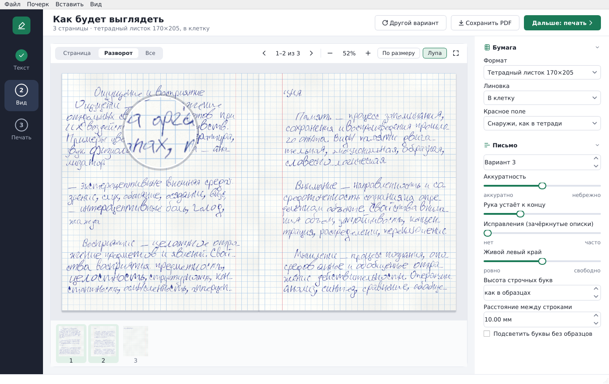
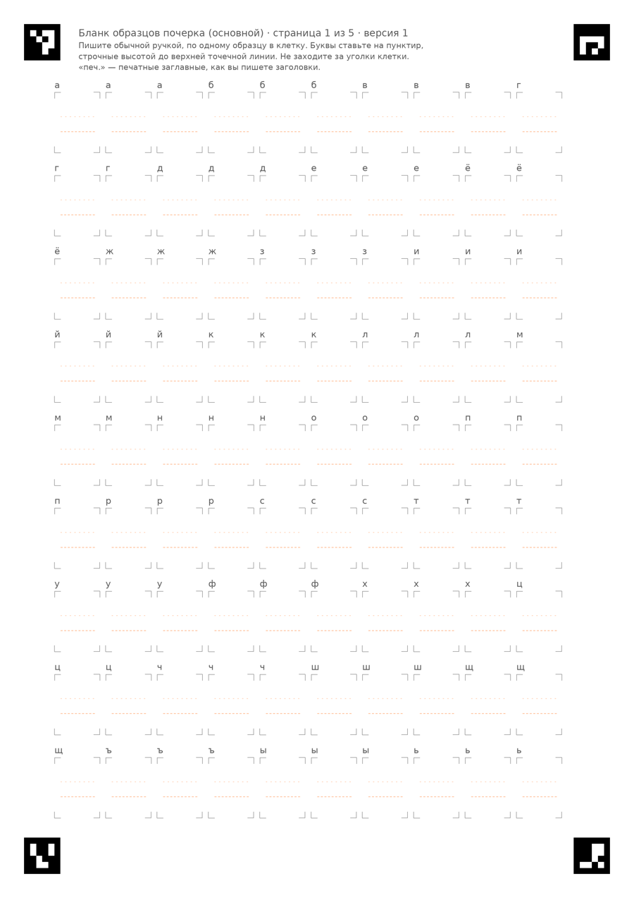
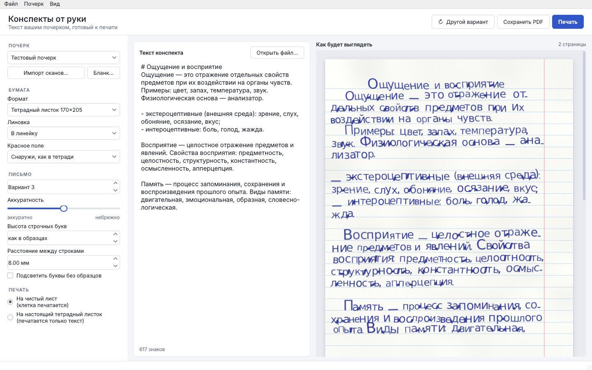
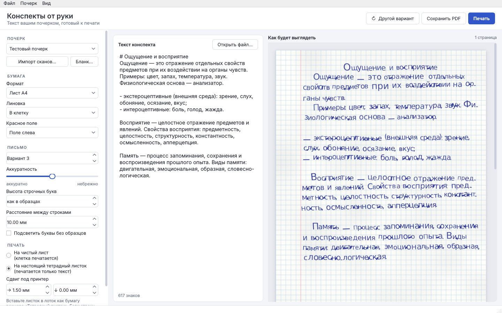

# Конспекты от руки

**Программа для Windows, которая печатает конспект вашим собственным почерком.**
Вставляете текст, и получаете страницы, будто написанные вашей ручкой: в
клетку или в линейку, с красным полем, на тетрадном листке или листе A4.
Можно напечатать на чистой бумаге или прямо на настоящий двойной листок из
тетради.

Это не рукописный шрифт. Программа берёт **ваши настоящие буквы**: вы один
раз заполняете бланк ручкой, сканируете его, и программа вырезает каждую
букву. При письме она берёт разные варианты одной буквы, целые слова и
сочетания, слегка гуляющую строку и наклон, поэтому текст не выглядит
одинаково-напечатанным.

Работает полностью **без интернета**, ваш почерк никуда не отправляется.



## Скачать

**[Скачать Konspekt-windows.zip](https://github.com/Carpmana/konspekty./releases/latest/download/Konspekt-windows.zip)**
(Windows 10/11, около 150 МБ)

1. Распакуйте архив в любую папку.
2. Запустите `Konspekt\Konspekt.exe`. Устанавливать ничего не нужно.
3. Если Windows покажет «Система Windows защитила ваш компьютер», нажмите
   «Подробнее», затем «Выполнить в любом случае». Так бывает с любой
   программой без платной цифровой подписи.

Все версии: [Releases](https://github.com/Carpmana/konspekty./releases).

## Как начать

1. **Бланк.** В программе: «Почерк → Сохранить основной бланк». Распечатайте
   его в реальном размере (масштаб 100%).

   

2. **Заполните ручкой**, которой обычно пишете: по одной букве или слову в
   клетку, буквы на пунктир.
3. **Отсканируйте** или сфотографируйте телефоном при ровном свете. Лист
   должен быть виден целиком, вместе с четырьмя чёрными квадратами по углам.
4. **«Импорт сканов…»** — укажите файлы (PDF, JPG, PNG) и имя профиля, например
   «Мой почерк». Импорт занимает около минуты.
5. **Вставьте текст** и смотрите страницы справа. «Другой вариант» пишет тот
   же текст по-другому.
6. **«Печать»** или **«Сохранить PDF»**.

Хотите больше разнообразия букв? Кнопка «Бланк ▾» → «Дополнительный бланк»:
его можно заполнять сколько угодно раз, каждый скан добавляет новые варианты.

**Без сканера.** «Нарисовать…» открывает клетку, в которой букву пишут мышью,
на тачпаде или пером планшета. Каждый сохранённый вариант сразу попадает в
почерк; неудачный удаляется щелчком, и букву можно переписать.

**Неудачные и зачёркнутые образцы.** «Образцы букв…» показывает все варианты
каждой буквы: щелчок отключает плохой вариант. Зачёркнутые в бланке клетки
программа находит сама и предлагает отключить.

## Бумага и печать

| Формат | Что это |
|---|---|
| Тетрадный листок 170×205 | страница школьной тетради; поле снаружи, как в тетради: на 1-й и 3-й странице двойного листка справа, на 2-й и 4-й слева |
| Лист A4, A5 | обычная бумага, поле слева |

Линовка: в клетку (5 мм), в линейку (в тетради 8 мм) или без линий.



**Печать на настоящий тетрадный листок.** В разделе «Печать» выберите
«На настоящий тетрадный листок»: принтер напечатает только текст, а клетки
и поле уже есть на самом листке. Вставьте листок в лоток как бумагу размера
«Тетрадный листок» (170×205 мм). Если строки легли не точно по клеткам,
задайте сдвиг вправо или вниз в миллиметрах и напечатайте ещё раз; сдвиг
запоминается.



**Двойной листок целиком.** Отметьте «Двойной листок целиком»: развёрнутый
двойной листок (340×205 мм) вставляется в принтер узкой стороной, и на одну
сторону печатаются две страницы рядом — снаружи 4 и 1. Потом программа
просит перевернуть листок и печатает внутреннюю сторону — страницы 2 и 3.
Если оборот вышел вверх ногами, включите «Оборот вверх ногами». Принтер
должен уметь брать бумагу длиной 340 мм (обычно через ручную подачу).

Длинный конспект занимает несколько листков, они печатаются по одному, и
программа перед каждым шагом пишет, какой листок и какой стороной вставить.
С галочкой «Листки вкладывать друг в друга» получается тетрадка: листок 1
внешний (на нём первые и последние страницы), остальные вкладываются в него.
Без галочки листки идут стопкой: на листке 1 страницы 1–4, на листке 2 — 5–8.
Пустые стороны (например, оборот, когда текста на одну страницу) не печатаются.

## Оформление текста

Всё это есть в кнопке «Вставить ▾» над текстом, вручную писать не обязательно.

| В тексте | На листке |
|---|---|
| `# Дроби` | заголовок по центру |
| `- пункт` | пункт списка с тире |
| `1. Что такое дробь?` | вопрос с номером («Вставить → Вопрос с номером» сам ставит следующий номер) |
| `= Классная работа` | строка по центру |
| `>> Двадцать третье октября` | строка справа — дата на полях |
| `_важные слова_` | подчёркнуто от руки |
| `[[правило]]` | обведено рамкой |
| `->`, `=>`, `<-`, `<->` | стрелки |
| `x^2`, `a^{10}`, `H_2O` | степень и индекс |

Пустая строка — отступ, каждая строка — отдельный абзац.

**Живая рука.** Ползунок «Рука устаёт к концу»: к концу длинного конспекта
почерк становится крупнее и размашистее, строки уходят вверх. Ползунок
«Исправления»: изредка перед словом появляется описка, зачёркнутая одной-двумя
линиями.

**Текст из Word.** «Открыть файл…» берёт `.txt` и `.docx`: заголовки Word
становятся заголовками, списки — пунктами.

**Диктовка.** Кнопка «Диктовать» включает голосовой ввод Windows (то же, что
Win+H): говорите, и текст появляется в поле.

Профили почерков хранятся в `%APPDATA%\Konspekt\profiles` («Почерк → Открыть
папку профилей»). Профиль можно перенести на другой компьютер, скопировав его
папку.

## Для разработчиков

Нужен Python 3.10 или новее.

```
python -m venv .venv
.venv\Scripts\activate
pip install -r requirements.txt
python -m konspekt.gui
```

Собрать exe на Windows: `packaging\build_windows.bat`, результат —
`dist\Konspekt\Konspekt.exe`. Каждое изменение в main собирается на GitHub
Actions и выкладывается в Releases автоматически.

### Командная строка

1. **Бланк.** `python -m konspekt template бланк.pdf` — 5 страниц A4.
   Распечатайте без масштабирования («реальный размер»).
2. **Заполнение.** Пишите обычной ручкой (синей или чёрной), по одному
   образцу в клетку, буквы ставьте на пунктир. «печ.» — заглавные так, как
   вы пишете заголовки. Слова и сочетания пишите слитно, как обычно.
3. **Скан или фото.** Лист должен быть виден целиком вместе с четырьмя
   чёрными квадратами по углам. Подойдёт фото с телефона при ровном свете.
4. **Импорт.** `python -m konspekt import "Мой почерк" скан.pdf фото2.jpg`
   Профиль создаётся в папке `profiles/`. Можно добавлять сканы повторно —
   образцы дополняются.
5. **Проверка полноты.** `python -m konspekt report "Мой почерк"` —
   каких символов нет или есть только один вариант, у каких частых букв
   мало вариантов.
6. **Больше вариантов.** `python -m konspekt template --set extra доп.pdf` —
   дополнительный бланк (4 стр.): ещё варианты частых букв, сочетания
   («ст», «ов», «ия»…) и слова целиком. Его можно распечатать и заполнить
   **несколько раз**: каждый новый скан добавляет варианты в тот же профиль.
   Один и тот же файл повторно не импортируется.
7. **Конспект.** `python -m konspekt render "Мой почерк" текст.txt конспект.pdf`

Параметры `render`: `--paper grid|lines|blank`, `--page A4|A5`,
`--seed 5` (другой вариант оформления того же текста), `--neatness 0.7`
(аккуратнее) или `1.4` (небрежнее), `--size 4` (высота строчных, мм),
`--pitch 10` (шаг строк, мм), `--show-missing` (подсветить символы без
образцов).

Разметка текста: `# Заголовок`, `- пункт списка`, пустая строка — отступ.
Каждая строка файла — отдельный абзац.

## Что делает текст похожим на рукописный

- Несколько настоящих образцов каждой буквы, один и тот же не ставится подряд.
- Частые слова и сочетания («что», «это», «ст», «пр»…) берутся целиком —
  с настоящими соединениями.
- Часть соседних строчных соединяется дорисованным штрихом (доля задаётся
  в профиле, `join_prob`).
- Строка плавно уходит вверх и волнится, наклон меняется от слова к слову
  постепенно, к концу страницы почерк чуть небрежнее.
- Переносы по слогам, иногда заход за правый край, как у живого человека.

## Честные ограничения

- Соединения в связном письме дорисовываются простой кривой. При
  внимательном рассмотрении стыки заметны; лучше всего помогают образцы
  сочетаний и слов.
- Символы без образцов берутся из запасного шрифта DejaVu Sans и выглядят
  чужими. Программа сообщает о них.
- Фото свободных конспектов (не бланка) пока не импортируются.
- Из формул — только степени, индексы и стрелки; дробей «столбиком» и схем
  с ветками нет.
- Распечатка с принтера всё равно отличается от ручки на ощупь.

### Тесты

```
pip install -r requirements-dev.txt
python -m pytest
```

Тесты заполняют бланк шрифтом, «фотографируют» его с перспективой и шумом,
импортируют и проверяют, что найдены все клетки, текст на страницах
совпадает с исходным слово в слово, результат воспроизводим по `seed`.

Шрифт `konspekt/assets/DejaVuSans.ttf` распространяется по лицензии
DejaVu Fonts (см. `DejaVu-LICENSE.txt`).
