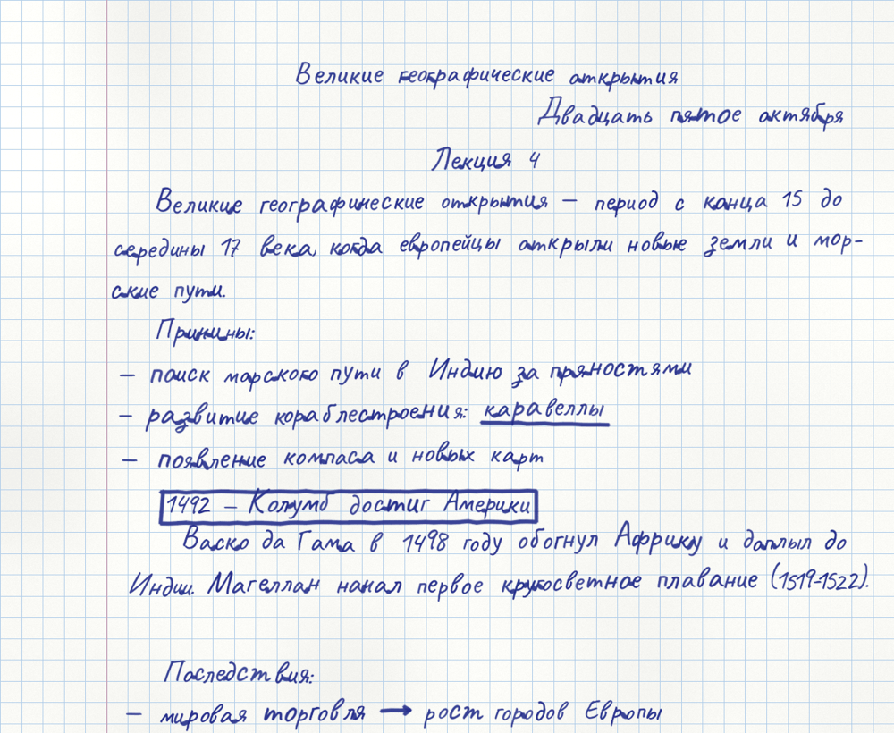
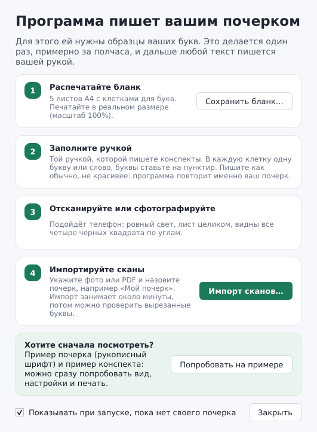
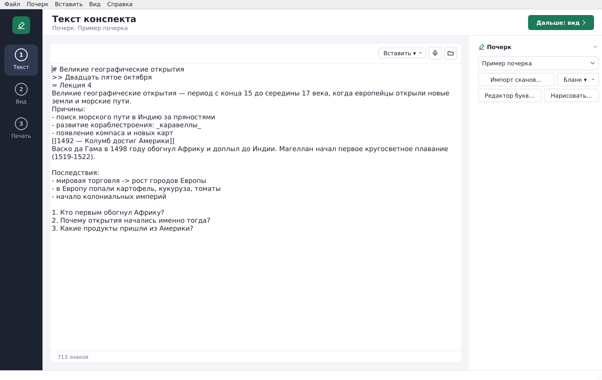

# Конспекты от руки

**Программа для Windows, которая пишет конспект вашим собственным почерком.**
Вставляете текст, и получаете страницы, будто написанные вашей ручкой: в
клетку или в линейку, с красным полем, на тетрадном листке или листе A4.
Печатать можно на чистую бумагу или прямо на настоящий двойной листок из
тетради, а программа на каждом шаге показывает, как вставить листок.



<sub>На картинках здесь пример почерка (рукописный шрифт Caveat). С вашим
бланком программа пишет вашими настоящими буквами.</sub>

**[⬇ Скачать для Windows](https://github.com/Carpmana/konspekty-ot-ruki/releases/latest/download/Konspekt-windows.zip)**
· бесплатно · без установки · работает без интернета

## Зачем это студенту

- **Часы вместо вечеров.** Конспект, который от руки пишется час, программа
  готовит за пару минут. Вам остаётся вставить текст и нажать «Печать».
- **Не отличить от рукописного.** Это не рукописный шрифт, а **ваши настоящие
  буквы**: вы один раз заполняете бланк ручкой, и программа вырезает каждую
  букву. Она берёт разные варианты одной буквы, целые слова и сочетания,
  слегка гуляющую строку, живой левый край и усталость руки к концу, поэтому
  две одинаковые буквы рядом не встречаются.
- **Печать прямо на тетрадный листок.** Программа печатает только текст на
  настоящий двойной листок и **показывает анимацией**, каким краем вставить
  листок в принтер, когда перевернуть и как сложить. Ошибиться сложно.
- **Оформление как у преподавателя на доске.** Заголовки, даты на полях,
  подчёркивания, рамки, стрелки, степени и индексы (`H_2O`, `x^2`), вопросы
  с номерами. Всё вставляется кнопкой, ничего учить не нужно.
- **Из Word и голосом.** Открывает `.docx` с заголовками и списками, умеет
  голосовой ввод Windows.
- **Ваш почерк остаётся у вас.** Программа работает без интернета, образцы
  букв никуда не отправляются.

### Сколько времени экономит

Примерно, если писать от руки в обычном темпе (около 10–12 слов в минуту).
Один раз нужно ещё полчаса, чтобы заполнить и отсканировать бланк.

| Что нужно сдать | От руки | С программой |
|---|---|---|
| Одна тетрадная страница (около 120 слов) | 10–15 минут | 1–2 минуты |
| Двойной листок, 4 страницы | около часа | 3–5 минут |
| Конспект на 12 страниц | 3 часа | 10 минут |
| Еженедельные конспекты за семестр | 15–25 часов | около 2 часов |

## Скачать и запустить

**[Скачать Konspekt-windows.zip](https://github.com/Carpmana/konspekty-ot-ruki/releases/latest/download/Konspekt-windows.zip)**
(Windows 10 или 11, около 115 МБ)

1. Распакуйте архив в любую папку (правой кнопкой → «Извлечь все…»).
2. Откройте папку `Konspekt` и запустите `Konspekt.exe`. Устанавливать
   ничего не нужно. Можно сделать ярлык на рабочий стол: правой кнопкой по
   `Konspekt.exe` → «Отправить» → «Рабочий стол (создать ярлык)».
3. Новые версии программа находит сама и предлагает обновиться.

### Если Windows пишет «Система Windows защитила ваш компьютер»

Это синее окно фильтра SmartScreen. Оно появляется у любой новой программы
без платной цифровой подписи и не значит, что в программе вирус.

1. Нажмите **«Подробнее»** (маленькая ссылка под текстом).
2. Появится кнопка **«Выполнить в любом случае»**, нажмите её.

Это нужно сделать только при первом запуске. Если браузер при скачивании
пишет «Этот файл обычно не скачивают», нажмите «…» или стрелку рядом с
файлом → «Сохранить» → «Всё равно сохранить».

Все версии: [Releases](https://github.com/Carpmana/konspekty-ot-ruki/releases).

## С чего начать

При первом запуске программа сама показывает, что делать:



1. **Распечатайте бланк.** Кнопка «Сохранить бланк…» (или «Бланк ▾» в окне).
   Это 5 листов A4, печатайте в реальном размере (масштаб 100%).

   

2. **Заполните ручкой**, которой обычно пишете конспекты: по одной букве или
   слову в клетку, буквы на пунктир. Пишите как обычно, не красивее.
3. **Отсканируйте или сфотографируйте** телефоном при ровном свете. Лист
   должен быть виден целиком, вместе с четырьмя чёрными квадратами по углам.
4. **«Импорт сканов…»**: укажите файлы (PDF, JPG, PNG) и имя почерка,
   например «Мой почерк». Импорт занимает около минуты. Потом откроется
   «Проверка букв»: все вырезанные буквы, а те, что упираются в край клетки
   (хвост «д» или «у» вылез за уголки и обрезан), в красной рамке и сразу не
   взяты. Щелчок по букве: брать её или нет.

**Хотите сначала посмотреть?** Кнопка «Попробовать на примере» (или
«Справка → Попробовать на примере почерка») за минуту делает пример почерка и
пример конспекта, и можно сразу попробовать вид, настройки и печать.

## Как пользоваться: Текст → Вид → Печать

Слева в окне три шага. Между ними можно переходить в любой момент.

**1. Текст.** Вставьте текст конспекта или откройте файл Word. Кнопка
«Вставить ▾» добавляет заголовок, дату, вопрос с номером, подчёркивание,
рамку, стрелку и степень.



**2. Вид.** Страницы так, как они выйдут на бумаге: по одной, разворотом или
все подряд. Лупа под мышкой показывает буквы крупно, двойной щелчок
открывает на весь экран. Справа формат бумаги, линовка и «живость» почерка;
у каждого ползунка есть кнопка «?» с объяснением. «Другой вариант» пишет тот
же текст по-другому. Здесь же «Сохранить PDF».


**3. Печать.** Слева план: что и в каком порядке пойдёт в принтер. Справа
анимация показывает, каким краем вставить листок (оранжевая полоса идёт в
принтер первой), когда его перевернуть и как сложить. Нажимаете «Дальше»,
и программа ведёт по шагам.


Хотите больше разнообразия букв? Кнопка «Бланк ▾» → «Дополнительный бланк»:
его можно заполнять сколько угодно раз, каждый скан добавляет новые варианты.

**Без сканера.** «Нарисовать…» открывает клетку, в которой букву пишут мышью,
на тачпаде или пером планшета. Каждый сохранённый вариант сразу попадает в
почерк; неудачный удаляется щелчком, и букву можно переписать.

**Редактор букв.** «Редактор букв…» (Ctrl+B) показывает все варианты каждой
буквы. Щелчок по варианту отключает его (программа его не берёт), второй
щелчок возвращает; «Удалить» убирает неудачный вариант совсем. Там же
меняется размер буквы в тексте и её высота над строкой (если буква «прыгает»),
а у каждого варианта свой размер в процентах. Строка «Проверка» сразу
показывает, как буква смотрится среди других. Всё применяется по «Сохранить».
Зачёркнутые в бланке клетки программа находит сама и предлагает отключить.

## Бумага и печать

| Формат | Что это |
|---|---|
| Тетрадный листок 170×205 | страница школьной тетради; поле снаружи, как в тетради: на 1-й и 3-й странице двойного листка справа, на 2-й и 4-й слева |
| Лист A4, A5 | обычная бумага, поле слева |

Линовка: в клетку (5 мм), в линейку (в тетради 8 мм) или без линий.


**Печать на настоящий тетрадный листок.** На шаге «Печать» выберите
«На настоящий тетрадный листок»: принтер напечатает только текст, а клетки
и поле уже есть на самом листке. Вставьте листок в лоток как бумагу размера
«Тетрадный листок» (170×205 мм). Если строки легли не точно по клеткам,
задайте сдвиг вправо или вниз в миллиметрах и напечатайте ещё раз; сдвиг
запоминается.

**Двойной листок целиком.** Отметьте «Двойной листок целиком»: развёрнутый
двойной листок (340×205 мм) вставляется в принтер узкой стороной, и на одну
сторону печатаются две страницы рядом — снаружи 4 и 1. Потом программа
просит перевернуть листок и печатает внутреннюю сторону — страницы 2 и 3.
Если оборот вышел вверх ногами, включите «Оборот вверх ногами».
«Сдвиг под принтер» двигает всю сторону листка целиком, поэтому начало строк
на правой странице у сгиба не обрезается. Принтер
должен уметь брать бумагу длиной 340 мм (обычно через ручную подачу).

Длинный конспект занимает несколько листков, они печатаются по одному, и
программа перед каждым шагом показывает, какой листок и какой стороной
вставить. Оранжевая полоса на картинке — край, который идёт в принтер
первым. Если текст вышел не на той стороне, поменяйте «Принтер печатает
на стороне, которая в лотке: сверху / снизу» — это запоминается.
С галочкой «Листки вкладывать друг в друга» получается тетрадка: листок 1
внешний (на нём первые и последние страницы), остальные вкладываются в него.
Без галочки листки идут стопкой: на листке 1 страницы 1–4, на листке 2 — 5–8.
Пустые стороны (например, оборот, когда текста на одну страницу) не печатаются.

## Оформление текста

Всё это есть в кнопке «Вставить ▾» над текстом, вручную писать не обязательно.

| В тексте | На листке |
|---|---|
| `# Дроби` | заголовок по центру |
| `- пункт` | пункт списка с тире |
| `1. Что такое дробь?` | вопрос с номером («Вставить → Вопрос с номером» сам ставит следующий номер) |
| `= Классная работа` | строка по центру |
| `>> Двадцать третье октября` | строка справа — дата на полях |
| `_важные слова_` | подчёркнуто от руки |
| `[[правило]]` | обведено рамкой |
| `->`, `=>`, `<-`, `<->` | стрелки |
| `x^2`, `a^{10}`, `H_2O` | степень и индекс |

Пустая строка — отступ, каждая строка — отдельный абзац.

**Живая рука.** Ползунок «Живой левый край»: человек не начинает каждую
строку в одной и той же клетке — начало строк немного гуляет и медленно
плывёт по странице, изредка строка начинается правее; за красное поле текст
не заходит. Ползунок «Гладкость линии»: буквы обводятся гладким контуром и
печатаются сплошной линией с чистым краем, как шрифт (без зерна и пропусков
шариковой ручки), правее — изгибы плавнее; 0 — точно как в скане. «Цвет
ручки» в разделе «Почерк»: синяя или чёрная, чем бы ни были написаны образцы. Ползунок «Рука устаёт к концу»: к концу длинного конспекта
почерк становится крупнее и размашистее, строки уходят вверх. Ползунок
«Исправления»: изредка перед словом появляется описка, зачёркнутая одной-двумя
линиями.

**Несколько конспектов сразу.** «Файл → Новое окно» (Ctrl+Alt+N) открывает
ещё одно окно программы с пустым текстом; «Новый конспект» (Ctrl+N) очищает
поле в текущем окне (прежний текст вернёт Ctrl+Z).

**Текст из Word.** «Открыть файл…» берёт `.txt` и `.docx`: заголовки Word
становятся заголовками, списки — пунктами.

**Диктовка.** Кнопка «Диктовать» включает голосовой ввод Windows (то же, что
Win+H): говорите, и текст появляется в поле.

Профили почерков хранятся в `%APPDATA%\Konspekt\profiles` («Почерк → Открыть
папку профилей»). Профиль можно перенести на другой компьютер, скопировав его
папку.

## Для разработчиков

Нужен Python 3.10 или новее.

```
python -m venv .venv
.venv\Scripts\activate
pip install -r requirements.txt
python -m konspekt.gui
```

Собрать exe на Windows: `packaging\build_windows.bat`, результат —
`dist\Konspekt\Konspekt.exe`. Каждое изменение в main собирается на GitHub
Actions и выкладывается в Releases автоматически.

### Командная строка

1. **Бланк.** `python -m konspekt template бланк.pdf` — 5 страниц A4.
   Распечатайте без масштабирования («реальный размер»).
2. **Заполнение.** Пишите обычной ручкой (синей или чёрной; цвет в конспекте
   задаётся отдельно, лучше всего выходит гелевая ручка или линер), по одному
   образцу в клетку, буквы ставьте на пунктир. «печ.» — заглавные так, как
   вы пишете заголовки. Слова и сочетания пишите слитно, как обычно.
3. **Скан или фото.** Лист должен быть виден целиком вместе с четырьмя
   чёрными квадратами по углам. Подойдёт фото с телефона при ровном свете.
4. **Импорт.** `python -m konspekt import "Мой почерк" скан.pdf фото2.jpg`
   Профиль создаётся в папке `profiles/`. Можно добавлять сканы повторно —
   образцы дополняются.
5. **Проверка полноты.** `python -m konspekt report "Мой почерк"` —
   каких символов нет или есть только один вариант, у каких частых букв
   мало вариантов.
6. **Больше вариантов.** `python -m konspekt template --set extra доп.pdf` —
   дополнительный бланк (4 стр.): ещё варианты частых букв, сочетания
   («ст», «ов», «ия»…) и слова целиком. Его можно распечатать и заполнить
   **несколько раз**: каждый новый скан добавляет варианты в тот же профиль.
   Один и тот же файл повторно не импортируется.
7. **Конспект.** `python -m konspekt render "Мой почерк" текст.txt конспект.pdf`

Параметры `render`: `--paper grid|lines|blank`, `--page A4|A5`,
`--seed 5` (другой вариант оформления того же текста), `--neatness 0.7`
(аккуратнее) или `1.4` (небрежнее), `--size 4` (высота строчных, мм),
`--pitch 10` (шаг строк, мм), `--smooth 0.5` (гладкость линии, 0–1), `--show-missing` (подсветить символы без
образцов).

Разметка текста: `# Заголовок`, `- пункт списка`, пустая строка — отступ.
Каждая строка файла — отдельный абзац.

## Что делает текст похожим на рукописный

- Несколько настоящих образцов каждой буквы, один и тот же не ставится подряд.
- Частые слова и сочетания («что», «это», «ст», «пр»…) берутся целиком —
  с настоящими соединениями.
- Часть соседних строчных соединяется дорисованным штрихом (доля задаётся
  в профиле, `join_prob`).
- Строка плавно уходит вверх и волнится, наклон меняется от слова к слову
  постепенно, к концу страницы почерк чуть небрежнее.
- Переносы по слогам, иногда заход за правый край, как у живого человека.

## Честные ограничения

- Соединения в связном письме дорисовываются простой кривой. При
  внимательном рассмотрении стыки заметны; лучше всего помогают образцы
  сочетаний и слов.
- Символы без образцов берутся из запасного шрифта DejaVu Sans и выглядят
  чужими. Программа сообщает о них.
- Фото свободных конспектов (не бланка) пока не импортируются.
- Из формул — только степени, индексы и стрелки; дробей «столбиком» и схем
  с ветками нет.
- Распечатка с принтера всё равно отличается от ручки на ощупь.

### Тесты

```
pip install -r requirements-dev.txt
python -m pytest
```

Тесты заполняют бланк шрифтом, «фотографируют» его с перспективой и шумом,
импортируют и проверяют, что найдены все клетки, текст на страницах
совпадает с исходным слово в слово, результат воспроизводим по `seed`.

Шрифт `konspekt/assets/DejaVuSans.ttf` распространяется по лицензии
DejaVu Fonts (см. `DejaVu-LICENSE.txt`).

Шрифт `konspekt/assets/Caveat.ttf` (для примера почерка) распространяется по
лицензии SIL Open Font License 1.1 (см. `Caveat-OFL.txt`).
